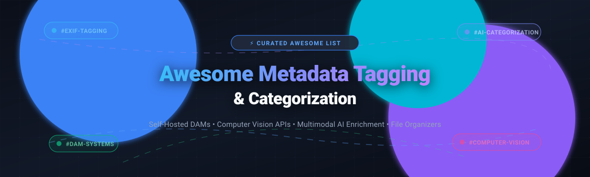

# 🏷️ Awesome Metadata Tagging & Categorization

  

  
  
  
  
  

> 🌟 **A curated directory of top Metadata Tagging, Content Categorization, Digital Asset Management (DAM), and Computer Vision AI solutions** — featuring enterprise SaaS APIs, commercial platforms, and powerful self-hosted open-source software for enriching files, photos, videos, and text with automated semantic metadata.
> 
> 💡 *Star this repository to keep track of the latest innovations in AI tagging, automated classification, and asset management.*

---

## 📑 Table of Contents

- [📊 Sector Overview & Market Dynamics](#-sector-overview--market-dynamics)
- [🟦 SaaS / Hosted Platforms](#-saas--hosted-platforms)
- [🟩 Open-Source Software](#-open-source-software)
  - [Immich](#immich-)
  - [Paperless-ngx](#paperless-ngx-)
  - [PhotoPrism](#photoprism-)
  - [spaCy](#spacy-)
  - [TagStudio](#tagstudio-)
  - [TagSpaces](#tagspaces-)
  - [ExifTool](#exiftool-)
  - [Sveltia CMS](#sveltia-cms-)
  - [Deep Learning Streamer (DL Streamer)](#deep-learning-streamer-dl-streamer-)
  - [DAMASK](#damask-)
  - [ResourceSpace](#resourcespace-)
  - [GINCO](#ginco-)
  - [Re3gistry](#re3gistry-)
  - [openmoderate](#openmoderate-)
- [📊 Comparison at a Glance](#-comparison-at-a-glance)
- [📈 Star History](#-star-history)
- [💖 Support & Sponsorship](#-support--sponsorship)
- [🤝 Contributing](#-contributing)
- [📄 License](#-license)

---

## 📊 Sector Overview & Market Dynamics

The global metadata tagging, digital asset management (DAM), and computer vision market is estimated at **$15B–$23B+** (with DAM specifically accounting for $4B–$6.5B and enterprise metadata management reaching $11B–$14.5B), expanding at a rapid 14%–20% CAGR. The sector exhibits a **moderately fragmented and layered** competitive structure: cloud hyperscalers (Microsoft, Google, AWS) dominate underlying baseline vision APIs and infrastructure, while an active, fragmented ecosystem of specialized DAM, media pipeline, and vertical AI vendors capture domain-specific workflows, enterprise governance, and brand categorization needs rather than a single winner-take-all monopoly.

---

## 🟦 SaaS / Hosted Platforms

Commercial, cloud-hosted Metadata Tagging and Categorization platforms. These are included as reference points for enterprise capabilities and cost benchmarking.

| Platform | Type / Focus | Market Cap / Valuation / Revenue | Starting Tier Pricing | Free Tier / Trial Limits |
| :--- | :--- | :--- | :--- | :--- |
| **Azure AI Vision** | Cloud computer vision with OCR & semantic tagging | ~$3.1T Market Cap (Microsoft) | $1.00 / 1,000 transactions (Standard S1 tier) | 5,000 transactions/month free forever (F0 tier, capped at 20 TPM) |
| **Google Cloud Video Intelligence** | Video analysis, shot changes & label detection | ~$2.1T Market Cap (Alphabet) | $0.10 / minute of video analyzed | 1,000 minutes of stored & streaming video processing free per month |
| **Amazon Rekognition** | AWS managed image & video analysis | ~$2.0T Market Cap (Amazon) | $1.00 / 1,000 images (first 1M images); $0.10 / min video | 1,000 images/month free for 12 months (Group 1 & 2 APIs each) + 1,000 face vectors |
| **Cloudinary** | Media asset management & AI transformation | $2B Valuation (~$100M+ ARR) | $89/month (Plus plan, 225 credits/month) | 25 credits/month free forever (up to 25k transformations, 25GB storage, or 25GB bandwidth; 3 users) |
| **Clarifai** | Computer vision AI platform for images & video | $775M Valuation (~$16M ARR) | $30/month (Essential plan) | 1,000 operations & 1,000 inputs/month free forever (Community plan; 1 application) |
| **Bynder DAM** | Enterprise digital asset management with AI metadata | ~$600M Valuation (~$130M ARR) | ~$450/month (Entry tier, billed annually ~$5,400/yr) | 14-day free trial (sales-assisted proof-of-concept environment; no self-serve free plan) |

---

## 🟩 Open-Source Software

Self-hosted, community-driven Metadata Tagging and Categorization tools sorted by GitHub star popularity. The open-source landscape spans **AI-powered photo and document organizers**, **local-first file taggers**, **database-driven asset managers**, **content moderation libraries**, **NLP pipelines**, and **reference data registries**.

### Immich 
**Stack:** TypeScript / Dart / Python / PostgreSQL | **License:** AGPL-3.0 | **GitHub:** [immich-app/immich](https://github.com/immich-app/immich)
Immich is a high-performance self-hosted photo and video backup solution with rich machine-learning metadata extraction.
- **Smart Search & Semantic Tagging**: Built-in machine learning models automatically detect objects, faces, scenes, and CLIP-based natural language queries.
- **Facial Recognition**: Automatically clusters and categorizes faces across thousands of images.
- **Geocoding & EXIF parsing**: Extracts GPS, camera specs, and reverse-geocodes locations into searchable tags.
- **Cross-Platform**: Mobile apps (iOS & Android) with background sync and web interface.
- **Best for:** Self-hosters and photographers wanting an all-in-one Google Photos replacement with local machine learning and instant metadata search.

### Paperless-ngx 
**Stack:** Python / Django / Angular | **License:** GPL-3.0 | **GitHub:** [paperless-ngx/paperless-ngx](https://github.com/paperless-ngx/paperless-ngx)
Paperless-ngx is a community-driven document management system that transforms physical documents into a searchable archive with automated metadata classification.
- **Automated Tagging & Matching**: Learns from your tagging habits to automatically assign tags, correspondents, and document types using machine learning.
- **OCR & Full-Text Search**: Optical Character Recognition via Tesseract extracts text and embedded metadata.
- **Email & Directory Ingestion**: Ingests scans from network scanners, folders, or email attachments automatically.
- **Granular Permissions**: Multi-user permissions with audit logging and workflow automation rules.
- **Best for:** Individuals and businesses wanting to organize and automatically tag scanned documents, receipts, and PDFs without manual filing.

### PhotoPrism 
**Stack:** Go / Vue.js / TensorFlow / MariaDB | **License:** AGPL-3.0 | **GitHub:** [photoprism/photoprism](https://github.com/photoprism/photoprism)
PhotoPrism is an AI-powered media library for personal collections and professional photographers that categorizes photos on ingest.
- **Automatic Image Classification**: Uses pre-trained TensorFlow models to tag images based on scenes, colors, and subject matter without cloud dependencies.
- **Facial Clustering**: Detects and groups faces with privacy-first local processing.
- **Places & Maps**: Converts EXIF GPS coordinates into geographic categories, country tags, and interactive maps.
- **Non-Destructive**: Reads original files without altering file headers or directories.
- **Best for:** Photographers and homelab users needing automatic visual tagging and geolocation indexing for huge raw and JPEG collections.

### spaCy 
**Stack:** Python / Cython | **License:** MIT | **GitHub:** [explosion/spaCy](https://github.com/explosion/spaCy)
spaCy is an industrial-strength natural language processing (NLP) library for extracting structured information, categories, and metadata from raw text.
- **Multilingual Support**: Over 75 languages with 84+ trained pipelines for entity extraction and syntax analysis.
- **Named Entity Recognition (NER)**: Identifies persons, organizations, locations, dates, and domain-specific concepts for document tagging.
- **Text Categorization**: Robust classification architecture for routing, sentiment tagging, and multi-label tagging.
- **Transformer Pipelines**: Seamless integration with Hugging Face transformers, PyTorch, and ONNX.
- **Best for:** Developers building enterprise text extraction pipelines, metadata enrichment engines, and semantic classifiers.

### TagStudio 
**Stack:** Python / Qt / SQLite | **License:** GPL-3.0 | **GitHub:** [TagStudioDev/TagStudio](https://github.com/TagStudioDev/TagStudio)
TagStudio is a desktop, database-driven digital asset manager that organizes media files with rich metadata without altering file locations.
- **Hierarchical Tagging**: Supports parent-child tag relationships, inheritance, aliases, and custom color palettes.
- **Non-Destructive Database**: Metadata and custom attributes are stored in an external SQLite database without writing to file headers.
- **Multi-Format Preview**: Renders thumbnails, video playback, audio waves, and document previews.
- **No File Relocation**: Keeps existing folder hierarchies intact.
- **Best for:** Digital collectors, artists, and creators wanting hierarchical metadata and tag taxonomies without altering local directories.

### TagSpaces 
**Stack:** React / TypeScript / Electron | **License:** AGPL-3.0 | **GitHub:** [tagspaces/tagspaces](https://github.com/tagspaces/tagspaces)
TagSpaces is an offline-first, privacy-focused file organizer that saves tags directly into file names or adjacent sidecar files.
- **File-Centric Metadata**: Tags travel with files across drives, cloud storage (Nextcloud, Dropbox, Syncthing), and USB drives.
- **No Cloud or DB Lock-In**: Works straight on the filesystem with zero database migration worries.
- **Local AI Integration**: Leverages local Ollama LLMs for automated summaries, descriptions, and file tagging.
- **Multiple Perspectives**: Grid, list, gallery, kanban, geo-map, and calendar views.
- **Best for:** Privacy-conscious professionals needing cross-platform, decentralized file tagging that functions fully offline.

### ExifTool 
**Stack:** Perl | **License:** Artistic License / GPL | **GitHub:** [exiftool/exiftool](https://github.com/exiftool/exiftool)
ExifTool by Phil Harvey is the global gold standard CLI and library for reading, writing, and manipulating multimedia metadata.
- **Exhaustive Format Support**: Reads and writes EXIF, GPS, IPTC, XMP, JFIF, MakerNotes, ICC Profiles, ID3, and hundreds of proprietary formats.
- **Batch Processing**: Powerful command-line switches for renaming, mass-tagging, shifting timestamps, and copying metadata between files.
- **Metadata Sanitization**: Removes privacy-sensitive metadata (GPS coordinates, author names, serial numbers) before publishing.
- **Ubiquitous Integration**: The underlying engine behind countless DAMs, photography suites, and media pipelines worldwide.
- **Best for:** Developers, sysadmins, and archivists needing granular, programmatic control over raw media file metadata.

### Sveltia CMS 
**Stack:** Svelte / TypeScript | **License:** MIT | **GitHub:** [sveltia/sveltia-cms](https://github.com/sveltia/sveltia-cms)
Sveltia CMS is a modern Git-based headless content and digital asset management system designed as a drop-in upgrade for Decap/Netlify CMS.
- **Asset Management & Tagging**: Full media library interface with categorization, stock photo integration (Unsplash, Pexels), and asset insertion.
- **Git-Backed Metadata**: Saves all content structure, tags, and taxonomies directly into Git commits (Markdown/YAML/JSON).
- **Client-Side Speed**: Fast Svelte single-page interface with real-time preview and zero server-side runtime overhead.
- **Best for:** Web developers and content creators managing static sites and documentation with Git-native asset workflows.

### Deep Learning Streamer (DL Streamer) 
**Stack:** C++ / Python / GStreamer / OpenVINO | **License:** Apache-2.0 | **GitHub:** [open-edge-platform/dlstreamer](https://github.com/open-edge-platform/dlstreamer)
Intel DL Streamer is a streaming media analytics framework for constructing live video and audio intelligence pipelines.
- **Hardware Acceleration**: High-throughput execution optimized across Intel CPU, GPU, and NPU architectures.
- **Vision-Language Models**: Integrates CLIP, Whisper, and MiniCPM-V directly into real-time GStreamer video pipelines.
- **Metadata Standards**: Conforms to the GStreamer Analytics metadata specification for cross-pipeline interoperability.
- **Enterprise Messaging**: Direct metadata telemetry export to Kafka, MQTT, and IoT gateways.
- **Best for:** Engineers building automated high-throughput video surveillance, QA inspection, and real-time event tagging systems.

### DAMASK 
**Stack:** Fortran / Python / C | **License:** GPL-3.0 | **GitHub:** [damask-multiphysics/DAMASK](https://github.com/damask-multiphysics/DAMASK)
DAMASK (Düsseldorf Advanced Material Simulation Kit) is an open-source framework featuring structured hierarchical data indexing and HDF5-based crystal plasticity metadata categorization.
- **Scientific Metadata Hierarchies**: Standardized categorization and extraction of complex microstructural spatial data.
- **HDF5 Integration**: Big-data scientific tagging and schema validation.
- **Best for:** Materials science researchers and computational physics labs managing large-scale simulation artifacts and crystallographic datasets.

### ResourceSpace 
**Stack:** PHP / MySQL / Docker | **License:** BSD-3-Clause | **GitHub:** [resourcespace/resourcespace](https://github.com/resourcespace/resourcespace)
ResourceSpace is an established enterprise web-based DAM platform used by universities, museums, charities, and global enterprises.
- **Taxonomies & Structured Metadata**: Controlled vocabularies, auto-suggest tagging, and facet-based indexing.
- **Governance & Approval Queues**: Role-based permissions, asset statuses (Active, Pending Review, Archived), and rights compliance tracking.
- **Enterprise Authentication**: Single Sign-On (SSO), multi-factor authentication (MFA), and audit trails.
- **Best for:** Cultural institutions, universities, and enterprise brand teams needing governed DAM workflows with compliance rules.

### GINCO 
**Stack:** Java / Web Application | **License:** CeCILL v2 | **GitHub:** [culturegouv/ginco](https://github.com/culturegouv/ginco)
GINCO (*Gestion Informatisée de Nomenclatures Collaboratives et Ouvertes*) is developed by the French Ministry of Culture for managing controlled vocabularies and semantic thesauri.
- **Standards Compliant**: Built strictly on the ISO 25964-1:2011 standard with SKOS and RDF exports.
- **Multilingual Hierarchies**: Supports cross-lingual synonyms, preferred terms, and concept relationships.
- **Best for:** Libraries, archives, and government ministries curating official taxonomies and semantic thesauri.

### Re3gistry 
**Stack:** Java / Web Application | **License:** EUPL v1.1 | **GitHub:** [ec-jrc/re3gistry](https://github.com/ec-jrc/re3gistry)
Re3gistry is an open-source solution developed by the European Commission (EC-JRC) for managing and sharing reference code lists and registries.
- **INSPIRE Compliance**: Implements European geospatial and public administration reference data interoperability.
- **Multi-Format Distribution**: Exports reference schemas in HTML, XML, JSON, RDF, Atom, and CSV formats.
- **Best for:** Public sector administrations and inter-organizational bodies managing official code registries and identifier lists.

### openmoderate 
**Stack:** Python / CLIP / PyTorch | **License:** Apache-2.0 | **GitHub:** [karammm/openmoderate-image-moderation](https://github.com/karammm/openmoderate-image-moderation)
openmoderate is a lightweight, self-hosted image and video safety categorization library serving as a drop-in alternative to commercial moderation APIs.
- **Zero-Shot Policy Tagging**: Employs OpenAI's CLIP to classify nudity, violence, weapons, and unsafe content without custom training.
- **YAML Policy Declarations**: Define custom compliance rules and violation thresholds in simple configuration files.
- **Web Framework Integrations**: Native middleware support for FastAPI, Flask, and Django uploads.
- **Best for:** Developers needing cost-free, offline content safety filtering and moderation tagging on user-submitted media.

---

## 📊 Comparison at a Glance

| Software | License | Tech Stack | Media Type | AI / Automated Tagging | Self-Hosted | Primary Focus |
| :--- | :--- | :--- | :--- | :--- | :--- | :--- |
| **Immich** | AGPL-3.0 | TypeScript / Python | Photos / Videos | ✅ Facial recognition & CLIP search | ✅ | Personal photo/video backup & AI search |
| **Paperless-ngx** | GPL-3.0 | Python / Angular | Documents / PDFs | ✅ Machine learning document tags & OCR | ✅ | Document archiving & auto-categorization |
| **PhotoPrism** | AGPL-3.0 | Go / TensorFlow | Photos / Videos | ✅ TensorFlow classification & places | ✅ | Local AI photo library & geocoding |
| **spaCy** | MIT | Python / Cython | Text / Documents | ✅ NER & custom transformer classifiers | ✅ | Production NLP & structured text extraction |
| **TagStudio** | GPL-3.0 | Python / Qt | Any File | ❌ (Hierarchical taxonomy) | ✅ | Non-destructive desktop asset organization |
| **TagSpaces** | AGPL-3.0 | React / Electron | Any File | ✅ Local Ollama LLM integration | ✅ | File-based offline metadata organizer |
| **ExifTool** | Artistic/GPL | Perl | All Media Files | ❌ (Deep metadata CLI) | ✅ | Universal metadata extraction & batch editing |
| **Sveltia CMS** | MIT | Svelte / TypeScript | Web Media / Markdown | ❌ (Media manager & stock APIs) | ✅ | Git-backed headless CMS & asset manager |
| **DL Streamer** | Apache-2.0 | C++ / GStreamer | Video / Audio Streams | ✅ Intel OpenVINO & VLM inference | ✅ | High-throughput streaming analytics |
| **ResourceSpace** | BSD-3-Clause | PHP / MySQL | Any Asset | ❌ (Metadata schemas & workflows) | ✅ | Enterprise DAM with compliance & approvals |
| **GINCO** | CeCILL v2 | Java / Web | Thesauri / Taxonomies | ❌ (ISO 25964-1 thesauri curation) | ✅ | Controlled vocabulary & thesaurus management |
| **Re3gistry** | EUPL v1.1 | Java / Web | Reference Codes | ❌ (Standards-based registry) | ✅ | Reference code lists & INSPIRE registries |
| **openmoderate** | Apache-2.0 | Python / PyTorch | Images / Videos | ✅ Zero-shot CLIP moderation | ✅ | Offline safety classification & content filters |

---

## 📈 Star History

---

## 💖 Support & Sponsorship

If this curated repository saved you hours of research or inspired your tech stack, please consider supporting the project! 

Here are ways you can help:
- ⭐ **Star the repo** to help others discover it on GitHub.
- 🍴 **Fork the repo** to contribute new tools, fixes, or documentation updates.
- 📢 **Share the repository** with colleagues, DevOps engineers, and data science communities.
- ☕ **Buy a coffee / Sponsor the author** via the GitHub Sponsors Dashboard:  
  👉 **[Support on GitHub Sponsors](https://github.com/sponsors/ishandutta2007)**

Your support keeps this directory active, accurate, and continually updated! 🚀

---

## 🤝 Contributing

Contributions are always welcome! If you know of an outstanding open-source metadata tagging, automated categorization, or DAM tool that should be included:

1. Fork this repository.
2. Create a branch (`git checkout -b feature/new-tool`).
3. Add the project under the proper section in alphabetical or star-ranked order with license, stack, and standout features.
4. Open a Pull Request with a short summary explaining why the tool stands out.

Please ensure all submitted projects are actively maintained (updated within the last 12 months) and adhere to open-source licenses.

---

## 📄 License

This repository and curated list are released under the [CC0 1.0 Universal (Public Domain)](https://creativecommons.org/publicdomain/zero/1.0/) license. All listed software products, libraries, and trademarks belong to their respective copyright holders.

---

  Built with ❤️ for developers, data engineers, and archivists worldwide.

